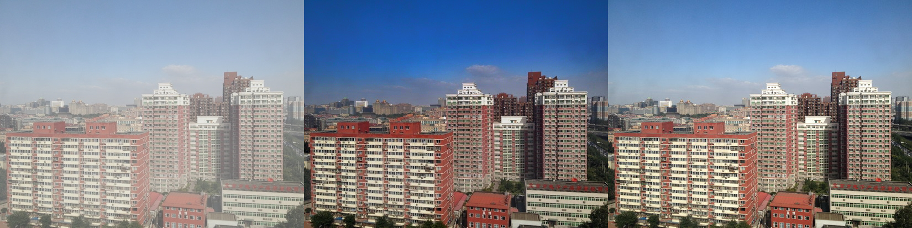
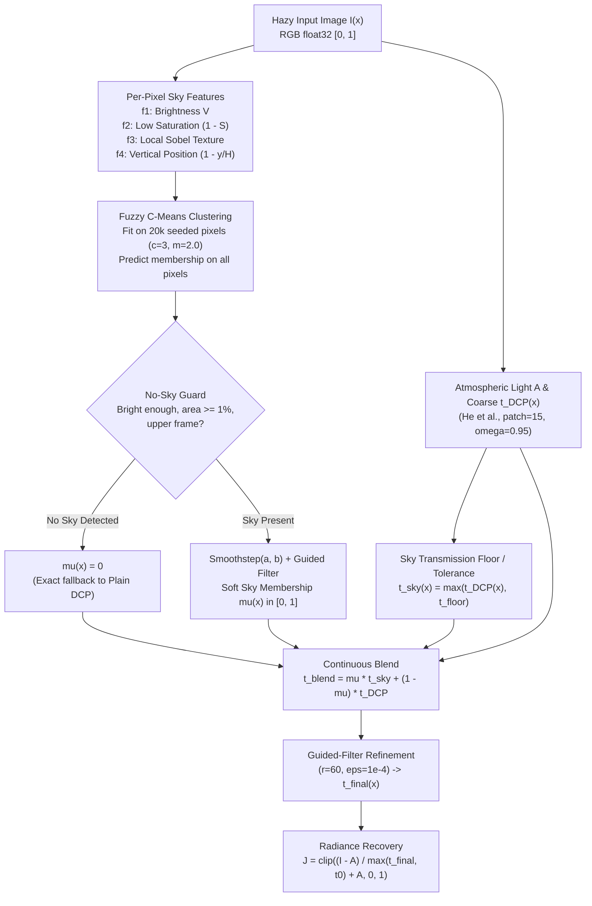

# Fuzzy Sky-Aware Transmission Refinement for Training-Free Single-Image Dehazing

[](https://www.python.org/)
[](https://opensource.org/licenses/MIT)

**Training-free single-image dehazing using multi-feature Fuzzy C-Means soft sky membership, continuous transmission blending, and Genetic Algorithm hyperparameter tuning.**

The Dark Channel Prior (DCP) restores contrast effectively on most outdoor scenes but breaks down on bright sky regions. Instead of a binary sky mask—which introduces a visible step-edge seam at the horizon—this repository computes a continuous **Fuzzy C-Means (FCM) soft sky membership** $\mu(x) \in [0, 1]$ over four spatial-appearance cues and blends sky and non-sky transmission estimates smoothly before edge-preserving guided filtering.

---

## Table of Contents

- [Motivation & Problem Statement](#motivation--problem-statement)
- [Proposed Method](#proposed-method)
- [Key Features](#key-features)
- [Project Structure](#project-structure)
- [Installation](#installation)
- [Dataset Setup](#dataset-setup)
- [Quick Start](#quick-start)
- [Reproducing the Experiments](#reproducing-the-experiments)
- [Experimental Results](#experimental-results)
- [Configuration](#configuration)
- [Testing](#testing)
- [Limitations](#limitations)
- [Related Work](#related-work)
- [Citation & References](#citation--references)
- [License](#license)

---

## Motivation & Problem Statement

Hazy outdoor images follow Koschmieder's **Atmospheric Scattering Model (ASM)**:

$$I(x) = J(x)\,t(x) + A\,\bigl(1 - t(x)\bigr)$$

where $I(x) \in [0, 1]^3$ is the observed hazy RGB image, $J(x) \in [0, 1]^3$ is the clear scene radiance, $A \in [0, 1]^3$ is the global atmospheric light, and $t(x) \in (0, 1]$ is the medium transmission map.

### Why Plain DCP Fails on Sky
DCP assumes that every local patch $\Omega(x)$ of a haze-free outdoor image has at least one color channel near zero. Sky, clouds, and bright white surfaces violate this prior:

1. In sky regions, $I_c(x) \approx A_c$ across all RGB channels, so $\min_{y \in \Omega(x)} \min_c (I_c(y) / A_c) \approx 1$.
2. Coarse transmission collapses to $t_{\text{DCP}}(x) = 1 - \omega(1) = 0.05$ (for $\omega = 0.95$), which is clamped to the lower bound $t_0 = 0.10$.
3. The radiance recovery step
   $$J(x) = \frac{I(x) - A}{\max\bigl(t(x),\, t_0\bigr)} + A$$
   divides by $0.10$, amplifying sensor noise, JPEG block artifacts, and slight color offsets $(I(x) - A)$ roughly **tenfold**.

**Visual example on RESIDE SOTS-outdoor (`0001` — Left: Hazy Input | Middle: B0 Plain DCP | Right: Clear Ground Truth):**



### Why Hard Sky Masks Leave Horizon Seams
Applying a binary sky threshold $M(x) = \mathbb{1}[\text{score}(x) > \tau]$ treats two adjacent pixels straddling the threshold (e.g., $0.79$ vs. $0.81$) with completely different transmission models, leaving a sharp halo or "cut-out" seam along tree lines, rooftops, and mountain ridges.

**Central Hypothesis:** A soft sky membership $\mu(x) \in [0, 1]$ from Fuzzy C-Means, used to continuously blend sky and non-sky transmission estimates, reduces color distortion and pixel saturation in sky regions relative to **both** plain DCP and hard-masked DCP, **without degrading non-sky restoration quality**.

---

## Proposed Method



### Design Principles
- **Soft, Continuous Transition:** $\mu(x) \in [0, 1]$ turns the binary horizon jump into a smooth ramp.
- **No-Sky Guard:** When a scene contains no sky (e.g., dense forest canopies), the guard sets $\mu(x) = 0$ everywhere so the pipeline reduces **identically** to plain DCP.
- **Strict Controlled Comparison:** Every method (`B0`, `B1`, `B2`, `F0`, `F1`) uses the exact same atmospheric-light estimator, DCP patch size ($15$), $\omega = 0.95$, $t_0 = 0.10$, and final guided filter ($r = 60, \epsilon = 10^{-4}$). Only the sky transmission handling differs.
- **Genetic Algorithm Tuning:** Only fuzzy-specific parameters (fuzzifier $m$, feature weights $w_{1..4}$, smoothstep edges $a, b$, smoothing radius $r_\mu$, and sky floor $t_{\text{floor}}$) are tuned via DEAP on an outdoor tuning set strictly disjoint from the test sets.

---

## Key Features

- **Plain DCP Baseline (`B0`)** with $O(N)$ box-filter Guided Image Filtering (`float64` internal moments for numerical stability at $\epsilon = 10^{-4}$).
- **Custom NumPy Fuzzy C-Means (`fcm.py`)** with deterministic initialization, $d = 0$ singularity handling, and subsampled fitting (cross-checked against `scikit-fuzzy` in unit tests).
- **Controlled Hard-Mask Baselines:**
  - `B1`: Grid-searched hard threshold sky mask.
  - `B2`: Hardened FCM mask ($M = \mathbb{1}[\mu_{\text{raw}} > 0.5]$) sharing the **exact same clustering** as the fuzzy pipeline.
- **Sky-Focused Evaluation Suite:** Full-image PSNR, SSIM, CIEDE2000 ($\Delta E_{00}$), Sky-only PSNR & $\Delta E_{00}$, Non-Sky PSNR, unclipped pixel saturation %, and distance-transform **Horizon-Seam Boundary Error**.
- **Statistical Rigor:** Paired Wilcoxon signed-rank tests, 10,000-resample bootstrap $95\%$ confidence intervals, and win-rate analysis across all images and the sky-heavy subset ($>20\%$ sky area).

---

## Project Structure

```text
fuzzy-sky-dehazing/
├── README.md
├── pyproject.toml
├── requirements.txt
├── requirements-tools.txt
├── configs/
│   ├── default.yaml            # Shared DCP, guided filter, FCM, and evaluation settings
│   ├── ga.yaml                 # Genetic Algorithm population, operators, and search bounds
│   └── datasets.yaml           # Dataset directory mappings and pairing rules
├── src/fsdehaze/
│   ├── __init__.py
│   ├── config.py               # YAML configuration loader
│   ├── io_utils.py             # RGB float32 [0,1] I/O and validated dataset pairing
│   ├── dcp.py                  # Dark channel, atmospheric light A, t_DCP, radiance recovery
│   ├── guided_filter.py        # O(N) edge-preserving guided filter
│   ├── sky_features.py         # Per-pixel brightness, saturation, texture, vertical position
│   ├── fcm.py                  # Vectorized NumPy Fuzzy C-Means implementation
│   ├── sky_membership.py       # Sky cluster selection, no-sky guard, smoothstep + smoothing
│   ├── sky_transmission.py     # Floor and tolerance sky transmission models
│   ├── pipelines.py            # End-to-end pipelines: B0, B1, B2, F0, F1
│   ├── metrics.py              # Full, sky-only, non-sky, saturation, and horizon-seam metrics
│   ├── cli.py                  # Single-image CLI with --save-debug intermediate outputs
│   ├── baselines/              # Hard-mask and reference baseline wrappers
│   ├── tuning/                 # DEAP Genetic Algorithm optimizer
│   ├── eval/                   # Resumable benchmark runner and paired statistical tests
│   └── viz/                    # Horizon-crop, 1D transmission profile, and report figures
├── scripts/
│   ├── make_sky_gt.py          # Offline SegFormer (ADE20K) sky mask generator for evaluation
│   ├── run_benchmark.py        # Benchmark evaluation runner producing per-image & summary CSVs
│   ├── tune_threshold.py       # Grid search for B1 hard-mask threshold tau
│   ├── tune_ga.py              # DEAP GA optimization script for F1
│   ├── make_figures.py         # Report figure and table generator
│   └── demo_app.py             # Interactive demo application
├── tests/                      # Pytest unit test suite
├── data/                       # Dataset images (git-ignored) and sky_fraction.csv metadata
└── results/
    ├── per_image/              # Per-image metric CSVs for each dataset and method
    ├── summary/                # Aggregated mean/std/median summary CSVs
    └── images/                 # Dehazed outputs, side-by-side comparisons, and t_final maps
```

---

## Installation

Requires **Python 3.10+**. A standard laptop CPU is sufficient for the entire pipeline; no GPU is required.

```bash
git clone https://github.com/Krish-Garg01/fuzzy-sky-dehazing.git
cd fuzzy-sky-dehazing
python -m venv .venv
source .venv/bin/activate            # Windows PowerShell: .venv\Scripts\Activate.ps1
pip install -r requirements.txt
pip install -e .
```

Optional tooling dependencies (used only offline to generate pseudo-ground-truth evaluation sky masks or no-reference metrics):

```bash
pip install -r requirements-tools.txt    # torch, transformers, pyiqa, streamlit
```

---

## Dataset Setup

Datasets are not redistributed in this repository. Place the downloaded archives under `data/` matching `configs/datasets.yaml`:

```text
data/
  reside/
    sots_outdoor/{hazy,clear}/      # 500 synthetic outdoor test pairs
    ots_subset/{hazy,clear}/        # 120 outdoor tuning pairs (disjoint from SOTS-outdoor)
  ohaze/{hazy,GT}/                  # 45 real outdoor haze pairs (NTIRE 2018)
  sky_masks/                        # Evaluation-only binary sky masks & sky_fraction.csv
```

| Dataset | Role | Pairs | Sky-Heavy Pairs ($>20\%$ sky) | Mean Sky Area | Source |
|---|---|---:|---:|---:|---|
| **RESIDE SOTS-outdoor** | Primary test set | 500 | 324 / 500 ($64.8\%$) | $27.1\%$ | [BookerDeWitt/RESIDE](https://github.com/BookerDeWitt/RESIDE) |
| **RESIDE OTS-subset** | GA & threshold tuning | 120 | 96 / 120 ($80.0\%$) | $31.4\%$ | [BookerDeWitt/RESIDE](https://github.com/BookerDeWitt/RESIDE) |
| **O-HAZE** | Real outdoor haze test set | 45 | 2 / 45 ($4.4\%$) | $3.8\%$ | [ETH Zurich NTIRE 2018](https://data.vision.ee.ethz.ch/cvl/ntire18/o-haze/) |

To generate evaluation-only pseudo-ground-truth sky masks and visual overlay previews from the clear images using SegFormer (`nvidia/segformer-b0-finetuned-ade-512-512`):

```bash
python scripts/make_sky_gt.py --datasets sots_outdoor ots_subset ohaze --preview
```

---

## Quick Start

### Command-Line Interface
Dehaze a single image and export intermediate debug maps (`dark`, `t_dcp`, `t_final`, `mu`):

```bash
python -m fsdehaze.cli dehaze \
    --input path/to/hazy.jpg \
    --method dcp \
    --config configs/default.yaml \
    --out results/dehazed.png \
    --save-debug
```

Supported methods: `dcp` (`B0`), `hard_threshold` (`B1`), `hard_fcm` (`B2`), `fuzzy` (`F0` default parameters, `F1` when `--params results/best_params.yaml` is supplied).

### Python API

```python
from fsdehaze.config import load_config
from fsdehaze.io_utils import load_image, save_image
from fsdehaze.pipelines import dehaze_dcp

cfg = load_config("configs/default.yaml")
hazy = load_image("path/to/hazy.jpg")
result = dehaze_dcp(hazy, cfg)
save_image("results/dehazed.png", result.J)
```

---

## Reproducing the Experiments

```bash
# 1. Run baseline B0 on SOTS-outdoor and O-HAZE
python scripts/run_benchmark.py --config configs/default.yaml \
    --datasets sots_outdoor ohaze --methods B0

# 2. Tune the hard-mask threshold tau (fair B1 baseline)
python scripts/tune_threshold.py --config configs/default.yaml

# 3. Tune fuzzy sky parameters with the Genetic Algorithm (F1)
python scripts/tune_ga.py --config configs/ga.yaml

# 4. Run all methods across all test benchmarks
python scripts/run_benchmark.py --config configs/default.yaml \
    --datasets sots_outdoor ohaze --methods B0 B1 B2 F0 F1

# 5. Generate report figures and LaTeX/Markdown summary tables
python scripts/make_figures.py --results results/per_image --out results/figures
```

| ID | Method Description |
|---|---|
| **B0** | Plain DCP (`He et al.`) with guided-filter transmission refinement |
| **B1** | DCP + hard-thresholded sky mask ($\tau$ grid-searched on `ots_subset`) |
| **B2** | DCP + hardened FCM sky mask ($\mu_{\text{raw}} > 0.5$, identical clustering to `F0`) |
| **B3** | Learning-based reference baseline |
| **F0** | Proposed Fuzzy Sky-Aware Dehazing (default parameters, no GA tuning) |
| **F1** | Proposed Fuzzy Sky-Aware Dehazing + GA-tuned parameters |

---

## Experimental Results

Every number reported below is produced directly by [`scripts/run_benchmark.py`](scripts/run_benchmark.py) and logged per image in [`results/per_image/`](results/per_image/) and [`results/summary/`](results/summary/). Cells marked `—` will be populated upon completion of Phases 2–6.

### 1. RESIDE SOTS-Outdoor (All 500 Test Pairs)

| Method | PSNR (dB) $\uparrow$ | SSIM $\uparrow$ | CIEDE2000 $\downarrow$ | Sky PSNR (dB) $\uparrow$ | Sky $\Delta E_{00}$ $\downarrow$ | Non-Sky PSNR (dB) $\uparrow$ | Sky Saturated % $\downarrow$ | Seam Error $\downarrow$ | Median Runtime (s) |
|---|---|---|---|---|---|---|---|---|---|
| **B0 Plain DCP** | $17.05 \pm 3.52$ | $0.8574 \pm 0.0555$ | — | — | — | — | — | — | $0.071\text{ s}$ |
| **B1 Hard Threshold** | — | — | — | — | — | — | — | — | — |
| **B2 Hard FCM** | — | — | — | — | — | — | — | — | — |
| **F0 Fuzzy (Default)** | — | — | — | — | — | — | — | — | — |
| **F1 Fuzzy + GA** | — | — | — | — | — | — | — | — | — |

> **Diagnostic Note on B0 SOTS-Outdoor PSNR:** With the pure uncapped He et al. atmospheric-light estimator (`top_frac = 0.001`), bright sky/cloud pixels ($>0.92$) yield $A \approx 0.94\text{–}1.00$ even on synthetic pairs generated with true $A = 0.80$, causing sky over-darkening ($17.05\text{ dB}$ mean PSNR, $0.8574$ mean SSIM). Applying the $A \le 220/255$ cap used in several reference implementations raises B0 PSNR to **$19.32\text{ dB}$**. All methods in this benchmark share the exact same uncapped $A$ estimator so the sky failure mode is evaluated without artificial clipping.

### 2. O-HAZE Real Outdoor Haze (All 45 Test Pairs)

| Method | PSNR (dB) $\uparrow$ | SSIM $\uparrow$ | CIEDE2000 $\downarrow$ | Sky PSNR (dB) $\uparrow$ | Sky $\Delta E_{00}$ $\downarrow$ | Non-Sky PSNR (dB) $\uparrow$ | Sky Saturated % $\downarrow$ | Seam Error $\downarrow$ | Median Runtime (s) |
|---|---|---|---|---|---|---|---|---|---|
| **B0 Plain DCP** | $15.86 \pm 2.52$ | $0.6448 \pm 0.0982$ | — | — | — | — | — | — | $0.272\text{ s}$ |
| **B1 Hard Threshold** | — | — | — | — | — | — | — | — | — |
| **B2 Hard FCM** | — | — | — | — | — | — | — | — | — |
| **F0 Fuzzy (Default)** | — | — | — | — | — | — | — | — | — |
| **F1 Fuzzy + GA** | — | — | — | — | — | — | — | — | — |

---

## Configuration

All pipeline parameters are controlled via [`configs/default.yaml`](configs/default.yaml):

| Section | Parameter | Default | Description |
|---|---|---|---|
| `dcp` | `patch` | `15` | Local square patch size $\Omega(x)$ for dark channel erosion |
| `dcp` | `omega` | `0.95` | Aerial perspective retention factor $\omega$ |
| `dcp` | `t0` | `0.1` | Lower transmission bound during radiance recovery |
| `dcp` | `top_frac` | `0.001` | Top $0.1\%$ brightest dark-channel pixels used to estimate $A$ |
| `guided_filter` | `r`, `eps` | `60`, `1e-4` | Edge-preserving guided filter radius and regularization for $t_{\text{final}}$ |
| `sky` | `clusters`, `fuzzifier` | `3`, `2.0` | Fuzzy C-Means cluster count $c$ and fuzziness exponent $m$ |
| `sky` | `smoothstep` | `{a: 0.2, b: 0.8}` | Lower and upper transition edges for soft membership $\mu$ |
| `sky` | `t_floor` | `0.8` | Minimum sky transmission floor $t_{\text{floor}}$ |
| `sky.guard` | `min_brightness`, `min_area_frac`, `max_mean_y` | `0.5`, `0.01`, `0.6` | No-sky guard thresholds |

---

## Testing

Run the unit test suite with `pytest`:

```bash
pytest -q
```

Tests verify:
- Dark channel, atmospheric light $A$, coarse transmission $t_{\text{DCP}}$, and radiance recovery on synthetic hazy images with known ground-truth $J, t, A$.
- Guided filter constant-preservation, step-edge sharpness vs. box blur, and cross-checks against `cv2.ximgproc.guidedFilter`.
- RGB `float32 [0, 1]` I/O round-trips, grayscale/RGBA conversions, and dataset pairing assertions.

---

## Limitations

- **Classical Prior Scope:** DCP-family methods are training-free and interpretable but achieve lower full-image PSNR on synthetic benchmarks than large deep dehazing networks; this work specifically targets the sky over-correction and horizon-seam failure modes of DCP.
- **Bright Non-Sky Structures:** Unsupervised clustering can confuse large white building facades or snow with sky; the vertical-position feature $f_4$ and no-sky guard reduce but do not completely eliminate false positives.
- **Pseudo Ground-Truth Sky Masks:** Evaluation sky masks are generated by a pretrained semantic segmentation model (SegFormer on ADE20K) rather than manual pixel-level annotation.
- **Homogeneous Daytime Haze:** Night-time dehazing, severe non-homogeneous smoke, and video temporal consistency are outside the scope of this project.

---

## Related Work

Sky-region compensation and fuzzy concepts in dehazing build upon prior literature:
- **He, Sun, Tang** (*TPAMI* 2011, 2013): Dark Channel Prior and Guided Image Filtering.
- **Park et al.** (*IEIE Trans.* 2017): Hand-designed 1D trapezoid fuzzy membership on intensity with variational refinement.
- **Shu et al.** (*arXiv:1902.07069*, 2019): Weighted fusion of foreground and sky transmission maps.
- **Lv et al.** (*Opt. Precis. Eng.* 2022) & **Yang et al.** (*J. Optoelectron.-Laser* 2024): Hard sky segmentation combined with tolerance/compensation transmission mechanisms.

This project investigates the combination of **4-feature unsupervised Fuzzy C-Means soft membership**, **continuous transmission blending with an automatic no-sky guard**, and **Genetic Algorithm tuning**, evaluated against a hardened FCM baseline sharing identical cluster assignments.

---

## Citation & References

1. K. He, J. Sun, and X. Tang, "Single Image Haze Removal Using Dark Channel Prior," *IEEE TPAMI*, vol. 33, no. 12, pp. 2341–2353, 2011.
2. K. He, J. Sun, and X. Tang, "Guided Image Filtering," *IEEE TPAMI*, vol. 35, no. 6, pp. 1397–1409, 2013.
3. J. C. Bezdek, R. Ehrlich, and W. Full, "FCM: The Fuzzy c-Means Clustering Algorithm," *Computers & Geosciences*, vol. 10, no. 2–3, pp. 191–203, 1984.
4. B. Li et al., "Benchmarking Single Image Dehazing and Beyond," *IEEE TIP*, vol. 28, no. 1, pp. 492–505, 2019.
5. C. O. Ancuti, C. Ancuti, R. Timofte, and C. De Vleeschouwer, "O-HAZE: A Dehazing Benchmark with Real Hazy and Haze-Free Outdoor Images," *CVPR Workshops (NTIRE)*, 2018.
6. F.-A. Fortin et al., "DEAP: Evolutionary Algorithms Made Easy," *JMLR*, vol. 13, pp. 2171–2175, 2012.

```bibtex
@misc{fuzzy_sky_dehazing,
  title  = {Fuzzy Sky-Aware Transmission Refinement for Training-Free Single-Image Dehazing},
  author = {Krish Garg},
  year   = {2026},
  url    = {https://github.com/Krish-Garg01/fuzzy-sky-dehazing}
}
```

---

## License

This project is released under the MIT License. Benchmark datasets retain their original licenses and are not redistributed in this repository.
